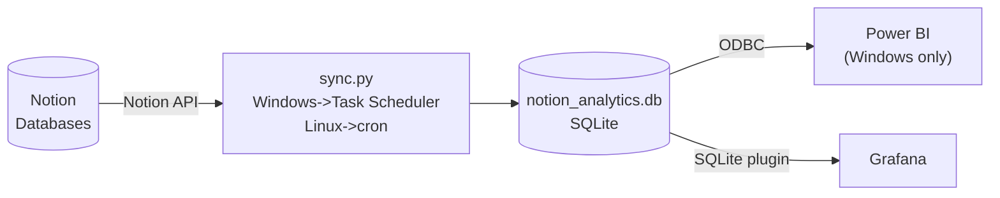

# Notion Analytics

[](LICENSE)

Notion is built for managing information, not analyzing it. Notion Analytics pulls your Notion databases into a local SQLite file on a schedule, enabling dashboards in Power BI or Grafana — with a full field-level change history so you can see exactly how your data evolved over time.

## Architecture



## Features

- **Incremental scheduled sync**: runs hourly via Task Scheduler (Windows) or cron / systemd (Linux), fetching only pages edited since the last successful run
- **Field-level change tracking**: every property change recorded with timestamps; full history of how your data evolved
- **Auto-schema evolution**: new Notion properties appear automatically on the next sync, no manual migration
- **Rename and type-change handling**: renames are followed by property id (declare them in config to keep history under one name); when a property's type changes in Notion the old values are kept in a backup column
- **Deleted and moved page detection**: opt-in `--detect-deleted` marks pages that were trashed, purged or moved, without deleting rows
- **Content and comment sync**: page body and comments captured as plain text
- **Safe database copies**: a snapshot tool makes consistent copies of the live SQLite file for another machine, plus a stale-data alert for copies that stop updating
- **CSV export**: optional alongside SQLite
- **Read-only toward Notion**: this project never writes to your workspace
- **Cross-platform**: Windows and Linux both supported

## Quick Start

```bash
git clone https://github.com/DreamShark-Bytes/Notion_Analytics.git
cd Notion_Analytics
python -m venv venv
venv/bin/python -m pip install -r requirements.txt        # Windows: venv\Scripts\python.exe -m pip
cp config_example.toml config.toml              # add your Notion token and a database ID
venv/bin/python sync.py                         # Windows: venv\Scripts\python
```

Your data is now in the SQLite file set by `db_path` in `config.toml`. Open it in [DB Browser for SQLite](https://sqlitebrowser.org/) to verify, then connect Power BI or Grafana. The [full setup guide](docs/setup.md) covers the Notion integration, every config option, scheduling and verification.

## Documentation

| | |
|---|---|
| [Setup](docs/setup.md) | From a fresh clone to a verified, scheduled sync |
| [Scheduling](docs/scheduling.md) | Task Scheduler, cron, systemd |
| [Guide](docs/guide.md) | Incremental vs full sync, change tracking, content sync, tips |
| [Reference](docs/reference.md) | Tables, columns, property types, schema changes, resetting |
| [Deleted and Moved Pages](docs/deleted-pages.md) | `--detect-deleted` and the soft-delete columns |
| [Backups and Database Copies](docs/backup-and-snapshots.md) | Safe copies, `tools/db_snapshot.py`, restoring |
| [Stale-Data Alert](docs/stale-data-alert.md) | Warning when a copy of the database stops updating |
| [Connecting Power BI and Grafana](docs/connecting-bi-tools.md) | ODBC, CSV, Grafana |
| [Updating](docs/updating.md) | Safe update procedure |
| [Troubleshooting](docs/troubleshooting.md) | Common errors and what they mean |

---

## Known Limitations

- Deleted and moved pages are only marked when you run `sync.py --detect-deleted`, and rows are never purged automatically
- A property's formula or rollup definition changing is not detected (only its type)
- Power BI Service publishing requires a work or school Microsoft account
- The stale-data alert uses Windows toast notifications

## Planned Features

- Status group tracking (the group each status option belongs to)
- Page icon capture
- Purging old deleted rows after a configurable lifespan
- Change-history backup outside the database file
- Configurable sync interval / daemon mode

## Dependencies & Related Projects

See [requirements.txt](requirements.txt) for the full dependency list.

- **[Notion_API](https://github.com/DreamShark-Bytes/Notion_API)** — shared Notion API client used by this project (pinned via `requirements.txt`)
- **[Notion_Automator](https://github.com/DreamShark-Bytes/Notion_Automator)** — companion daemon that writes automation logic back to Notion; this project reads what that one writes

---

## License

MIT License. See [LICENSE](LICENSE).

---

## Credits

Developed in collaboration with Claude Code by Anthropic. All architectural decisions, data model design, requirements definition, and production deployment are owned by the human author. Claude assisted with implementation, documentation, and code review under directed oversight — a design-led workflow where nothing ships without human review and approval.
